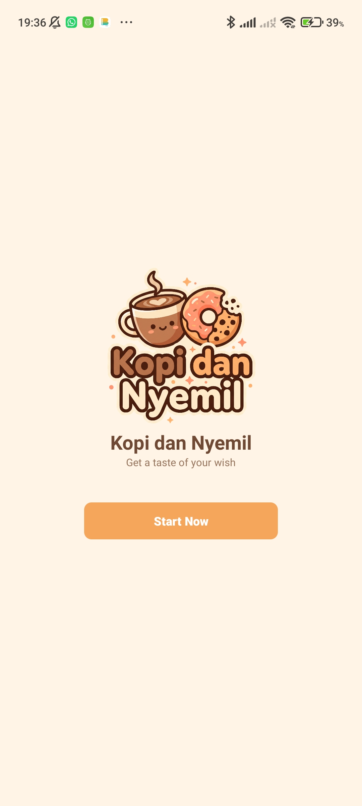
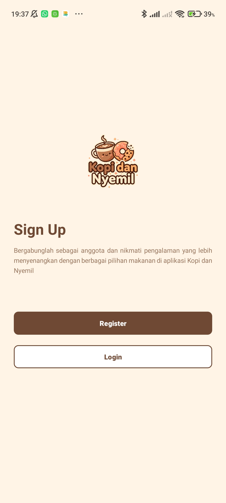
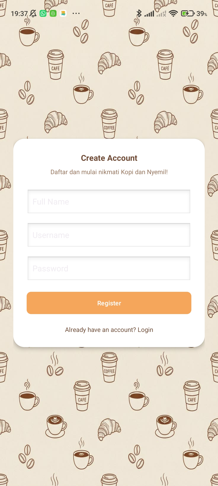
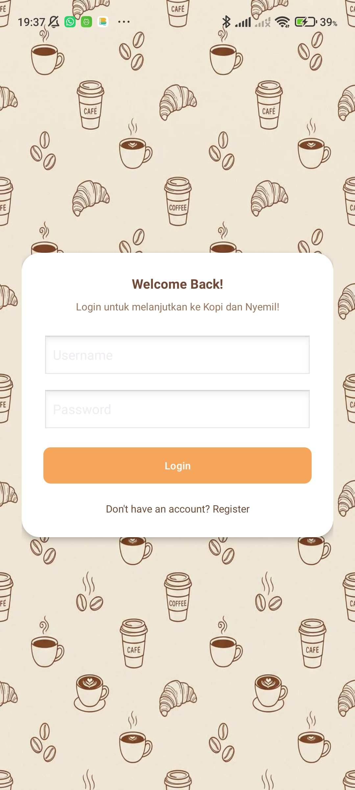
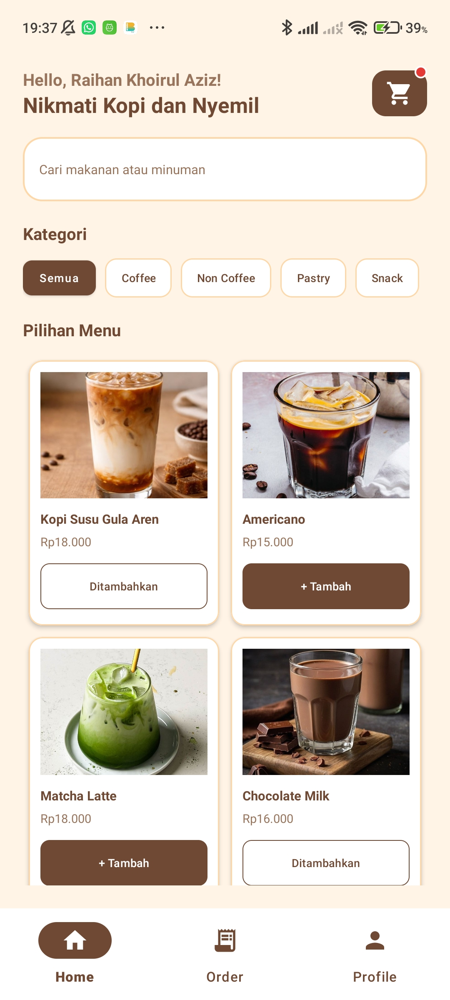
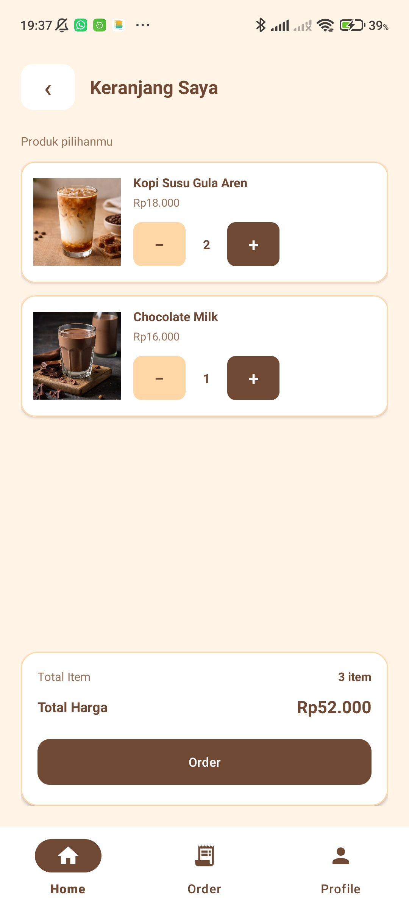
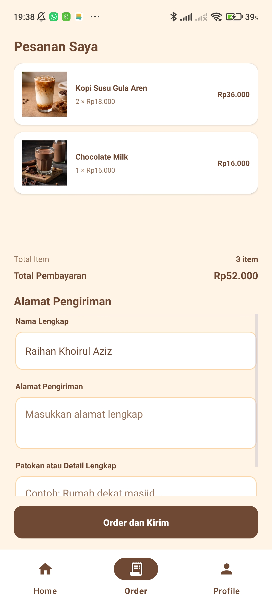
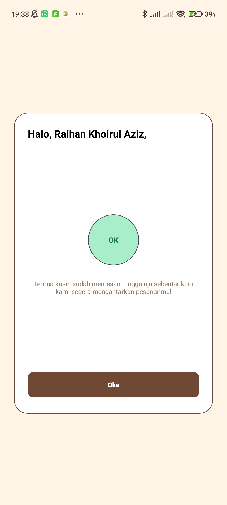
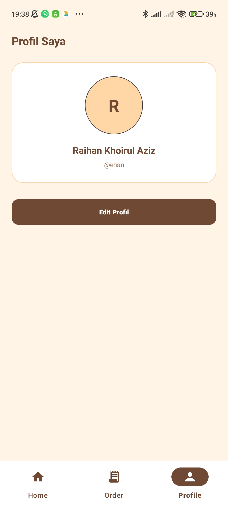
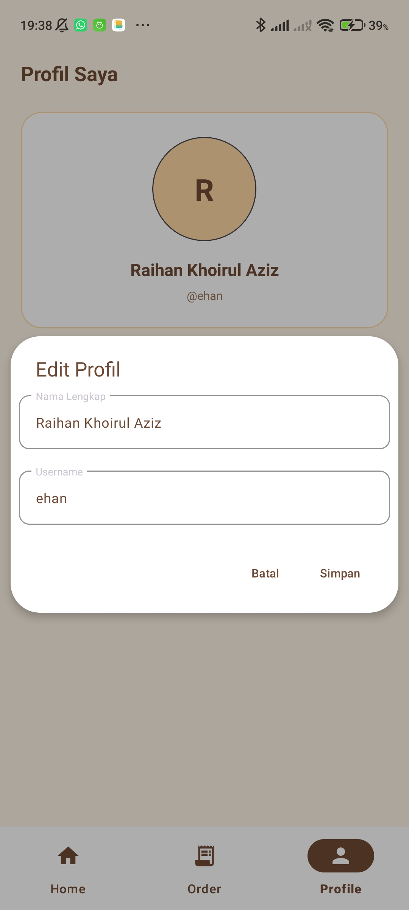

# ☕ Kopi dan Nyemil

**Get a taste of your wish**

---

## 📖 Deskripsi Aplikasi

---

Kopi dan Nyemil merupakan aplikasi pemesanan makanan dan minuman berbasis Android. Aplikasi ini dibuat untuk memudahkan pengguna dalam melihat pilihan menu, menambahkan produk ke keranjang, serta melakukan pemesanan dengan mengisi alamat pengiriman.

Aplikasi ini dikembangkan sebagai proyek Ujian Tengah Semester (UTS) mata kuliah Pemrograman Aplikasi Mobile.

---

## ✨ Fitur Aplikasi

---

- **Splash Screen** – Tampilan pembuka aplikasi.
- **Sign Up dan Register** – Halaman pendaftaran akun pengguna.
- **Login** – Pengguna dapat masuk menggunakan username dan password.
- **Home** – Menampilkan berbagai pilihan produk makanan dan minuman berdasarkan kategori.
- **Keranjang** – Pengguna dapat menambahkan produk, mengatur jumlah item, dan melihat total harga.
- **Order** – Menampilkan daftar pesanan, total item, total pembayaran, serta form alamat pengiriman.
- **Konfirmasi Pesanan** – Menampilkan informasi konfirmasi setelah pengguna menyelesaikan proses pemesanan.
- **Profil** – Menampilkan informasi akun pengguna serta menyediakan fitur untuk mengubah nama lengkap dan username.

---

## 🛠️ Teknologi yang Digunakan

---

- **Bahasa Pemrograman**: Kotlin
- **UI Framework**: Android XML (`LinearLayout`, `FrameLayout`, `ScrollView`, `NestedScrollView`)
- **Design System**: Material Design Components (`MaterialCardView`, `MaterialButton`, `TextInputLayout`, `BottomNavigationView`)
- **List Processing**: `RecyclerView` dan Custom Adapter untuk menampilkan daftar produk dan pesanan
- **Data Management**: State Management berbasis Singleton Object (`CartManager`) dan `SharedPreferences` (`UserData`) untuk penyimpanan data akun secara lokal
- **Navigasi**: `FragmentManager` dan `BottomNavigationView` untuk navigasi antarhalaman serta `Intent` untuk perpindahan Activity
- **IDE**: Android Studio (Quail 3)

---

## 🚀 Cara Menjalankan Aplikasi

---

1. Clone repository menggunakan perintah berikut:

   ```bash
   git clone https://github.com/USERNAME/NAMA-REPOSITORY.git
   ```

2. Buka Android Studio.
3. Pilih menu **Open**, kemudian pilih folder project hasil clone repository.
4. Tunggu hingga proses Gradle Sync selesai.
5. Hubungkan perangkat Android melalui USB atau jalankan Android Emulator.
6. Klik tombol **Run** untuk menjalankan aplikasi.

---

## 📱 Screenshot Tampilan Aplikasi

---

| Splash Screen | Sign Up / Welcome |
|:---:|:---:|
|  |  |
| **Register** | **Login** |
|  |  |
| **Home** | **Keranjang** |
|  |  |
| **Order** | **Konfirmasi Pesanan** |
|  |  |
| **Profil** | **Edit Profil** |
|  |  |

---

## 📝 Catatan

---

- Aplikasi menggunakan data produk statis (dummy data).
- Data akun pengguna disimpan secara lokal menggunakan `SharedPreferences`.
- Data keranjang dikelola menggunakan Singleton Object (`CartManager`).
- Aplikasi belum menggunakan database maupun backend server.

---

## 👨‍💻 Pengembang

---

**Raihan Khoirul Aziz**

Program Studi Teknik Informatika  
UIN Sunan Gunung Djati Bandung

**Kopi dan Nyemil** – Aplikasi Pemesanan Makanan dan Minuman Berbasis Android.